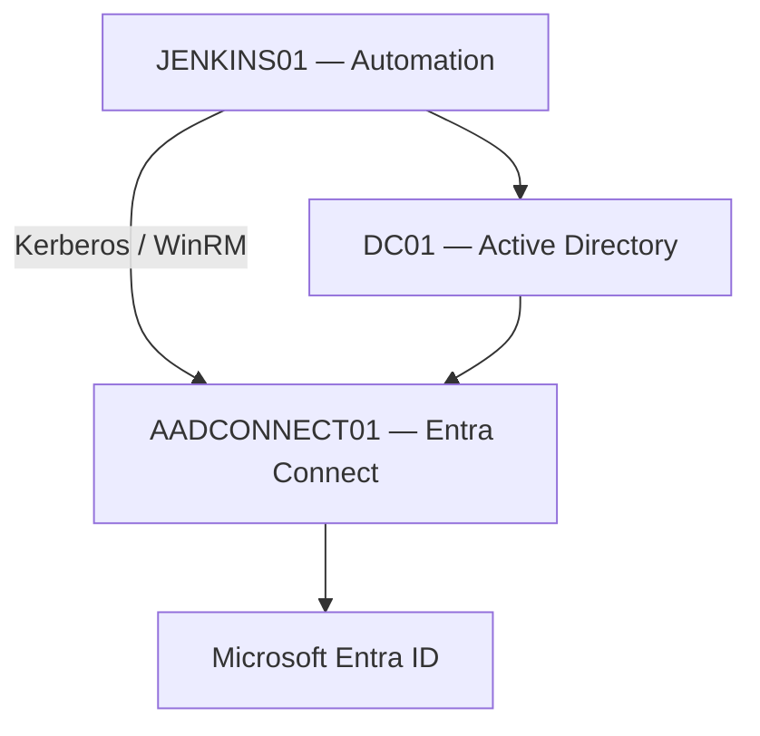

# Hybrid Identity Lab — IAM Lifecycle Automation

## Project overview

A personal IAM engineering lab demonstrating automated identity provisioning and offboarding across on-premises Active Directory and Microsoft Entra ID using PowerShell, Jenkins and Microsoft Entra Connect.

**Project status:** Operational and tested.

## Architecture

## Implemented capabilities

| Capability | Implementation |
| --- | --- |
| User provisioning | Parameterized account creation |
| Access assignment | AD security group membership |
| User offboarding | Account disablement and managed group removal |
| Hybrid synchronization | On-demand Entra Connect delta sync |
| Secrets management | Jenkins Credentials |
| Safety controls | OU boundaries and input validation |
| Error handling | PowerShell exceptions and Jenkins exit codes |
| Modular automation | Shared synchronization script |

## Technologies

Windows Server 2022 · Active Directory · Microsoft Entra ID · Entra Connect · Password Hash Synchronization (PHS) · PowerShell · Jenkins · VMware Workstation · Kerberos · WinRM · GitHub

## Technical documentation

| Document | Description |
| --- | --- |
| [Architecture](docs/architecture.md) | Infrastructure and identity workflows |
| [Jenkins configuration](docs/jenkins-configuration.md) | Job configuration and credential bindings |
| [Testing and validation](docs/testing-and-validation.md) | Functional, negative and security testing |
| [Operational runbook](docs/operational-runbook.md) | Operations, troubleshooting and maintenance |
| [Maintenance record](docs/maintenance/2026-11-19-hybrid-identity-lab.md) | Infrastructure maintenance and troubleshooting |

## Testing results

| Metric | Result |
| --- | --- |
| Documented test scenarios | 11 |
| Passed | 11 |
| Documented pass rate | 100% |

Results apply to the documented scenarios tested throughout the lab's development. See [testing and validation](docs/testing-and-validation.md) for details.

## Skills demonstrated

- Hybrid identity engineering
- Identity lifecycle management
- PowerShell and Jenkins automation
- Role-based access assignment
- Least-privilege administration
- Defensive programming
- Root cause analysis
- Technical documentation and version control

## Current limitations

- Offboarding removes only the configured security group.
- Cloud account verification is performed manually.
- Jenkins executes locally deployed scripts.
- Disaster recovery testing remains planned.

## Engineering roadmap

- Automated GitHub script retrieval through Jenkins.
- Microsoft Graph integration.
- Enhanced security group management.
- Automated audit logging.
- Disaster recovery validation.
- Mover lifecycle automation.

## Author

**Christian Liberté**

Identity & Access Management Specialist | SC-300 | Security+
