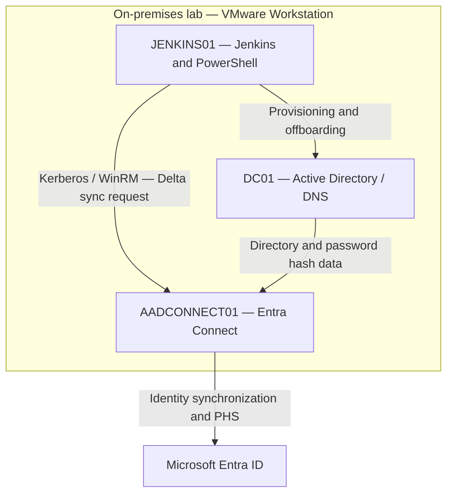

# Hybrid Identity Lab — Architecture

## 1. Environment overview

This personal, non-production IAM engineering lab runs three virtual machines on VMware Workstation and integrates on-premises Active Directory with Microsoft Entra ID. It demonstrates identity lifecycle automation, Microsoft Entra Connect Sync with Password Hash Synchronization (PHS), delegated administration and end-to-end validation.

## 2. Architecture diagram



The arrows represent logical automation and synchronization relationships, rather than a physical network diagram. Entra Connect reads directory data from AD and synchronizes in-scope identities to Microsoft Entra ID.

## 3. Infrastructure components

| Component | Responsibility |
| --- | --- |
| DC01 | Windows Server 2022, Active Directory Domain Services (AD DS) and DNS |
| AADCONNECT01 | Microsoft Entra Connect Sync, Password Hash Synchronization and directory synchronization |
| JENKINS01 | Parameterized Jenkins jobs and PowerShell automation for identity provisioning and offboarding |
| Microsoft Entra ID | Cloud identity directory and validation of synchronized account state |
| VMware Workstation | Virtualization platform hosting the three lab servers |

## 4. Active Directory design

The automation environment uses a dedicated organizational unit (OU) hierarchy:

```text
JenkinsAutomation
├── Users
├── Disabled Users
└── Groups
    └── GG_Helpdesk_Users (security group)
```

- **Users:** Managed test user accounts.
- **Disabled Users:** Accounts retained in AD after offboarding.
- **Groups:** Security groups used to demonstrate role-based access assignment.

Both the Users and Disabled Users OUs are included in Entra Connect synchronization scope. This allows the disabled account to remain synchronized rather than being removed from scope when it is relocated.

## 5. Identity provisioning workflow

1. The operator starts the parameterized Jenkins job to create a test user.
2. PowerShell creates the account in the managed Users OU and performs security group assignment.
3. Entra Connect synchronizes the in-scope identity to Microsoft Entra ID.
4. The operator verifies the resulting on-premises and cloud account state.

The November 2026 regression test confirmed account creation and group membership, but identified a discrepancy between the requested and observed group. Exact parameter-to-group mapping remains a follow-up validation item.

## 6. Identity offboarding workflow

1. The operator supplies the target test username to the Jenkins offboarding job.
2. PowerShell disables the account, removes managed security group access and moves the account to the Disabled Users OU.
3. The workflow validates the resulting AD account state and reports critical failures to Jenkins.
4. Jenkins uses Kerberos-authenticated PowerShell remoting (WinRM) to request a delta synchronization on AADCONNECT01.
5. Entra Connect propagates the on-premises changes to Microsoft Entra ID.
6. The operator verifies that the synchronized cloud account is disabled and remains present in the cloud directory.

A successful sync request alone does not establish that the cloud state has changed. Final cloud verification is a separate check. The offboarding workflow does not claim to revoke every effective permission or every existing cloud session.

## 7. Security architecture

- A dedicated Jenkins service account executes the automation using delegated permissions within the managed AD OU hierarchy.
- AD permissions are scoped to the required lifecycle operations rather than relying on Domain Admin privileges.
- Remote Management Users and ADSyncOperators permissions support the documented remote synchronization design.
- Kerberos-authenticated WinRM is used for remote synchronization requests.
- PowerShell error handling and post-action validation allow Jenkins to report failed operations instead of misleading success results.

## 8. Operational dependencies

- DC01 must be available for directory operations, DNS resolution and domain authentication.
- AADCONNECT01 requires working AD connectivity, DNS resolution, the ADSync service and connectivity to Microsoft Entra endpoints.
- JENKINS01 requires healthy domain connectivity, the appropriate PowerShell modules and delegated access for AD and remote synchronization tasks.
- Synchronization scope must include the relevant managed user OUs.

For planned restarts, the documented startup order is DC01, then AADCONNECT01, then JENKINS01. Shut down in reverse order.

See the [November 2026 maintenance and troubleshooting record](maintenance/2026-11-19-hybrid-identity-lab.md) for examples of DNS recovery, synchronization troubleshooting and regression testing.

## 9. Documentation safeguards

This document uses generic server names and omits domain names, IP addresses, tenant and object identifiers, credentials and certificate identifiers. It describes a personal lab, not an employer's production environment.
