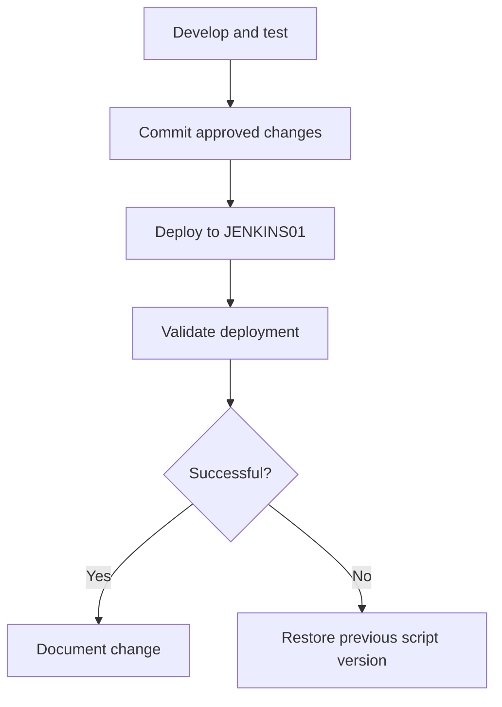

# Hybrid Identity Lab — Operational Runbook

## 1. Infrastructure overview

| Server | Function |
| --- | --- |
| DC01 | Active Directory Domain Services and DNS |
| AADCONNECT01 | Microsoft Entra Connect Sync |
| JENKINS01 | Identity lifecycle automation |

## 2. Startup and shutdown

**Startup sequence:**

1. DC01
2. AADCONNECT01
3. JENKINS01

Verify each server's required services before starting the next server.

**Shutdown sequence:**

1. JENKINS01
2. AADCONNECT01
3. DC01

Allow active automation jobs and synchronization cycles to complete before shutting down.

## 3. Operational health checks

### DC01

```powershell
Get-Service NTDS, DNS
```

### AADCONNECT01

```powershell
Get-Service ADSync
Import-Module ADSync
Get-ADSyncScheduler
```

### JENKINS01

```powershell
Get-Service Jenkins
Test-ComputerSecureChannel -Verbose
```

## 4. Identity lifecycle operations

| Operation | Jenkins job |
| --- | --- |
| User provisioning | Lab - Create AD Test User |
| User offboarding | Lab - Offboard AD Test User |
| On-demand synchronization | Lab - Trigger Entra Connect Delta Sync |

Following each lifecycle operation:

1. Review Jenkins console output.
2. Verify the on-premises AD account state.
3. Confirm synchronization completion.
4. Verify the expected Microsoft Entra ID account state.

## 5. Troubleshooting and recovery

| Issue | Corrective action |
| --- | --- |
| DNS resolution failure | Verify DC01 availability and DNS services |
| Domain trust issue | Check the computer secure channel |
| Synchronization failure | Inspect ADSync services, event logs and synchronization history |
| Duplicate user | Verify existing account state |
| Missing parameters | Verify Jenkins inputs and configuration |
| OU boundary rejection | Confirm the account is within an authorized OU |
| Partial workflow failure | Inspect completed operations before retrying |

Never bypass safety controls to force a workflow to succeed.

## 6. Script deployment and maintenance

GitHub serves as the authoritative source for approved scripts.



Jenkins currently executes locally deployed PowerShell scripts. Automatic retrieval from GitHub is not implemented.

## 7. Maintenance schedule

| Frequency | Activity |
| --- | --- |
| Each lab session | Infrastructure health checks |
| Weekly | Review build failures and synchronization errors |
| Weekly | VM and AD System State backups |
| Monthly | Review delegated permissions and credential management |
| Before major changes | Complete backups |
| After major changes | Regression testing |
| After approved script changes | GitHub commit |

## 8. Backup and disaster recovery

| Component | Backup method |
| --- | --- |
| DC01 | VM backup and AD System State backup |
| AADCONNECT01 | VM backup and configuration export |
| JENKINS01 | VM backup and Jenkins configuration backup |
| PowerShell scripts | GitHub version control |

Retain backups on separate physical storage and restrict access to sensitive backup files.

Perform recovery testing in an isolated environment to prevent restored identities or synchronization services from affecting the active environment.

### Recovery readiness

| Capability | Status |
| --- | --- |
| Cold VM backup | Completed |
| AD System State backup | Planned |
| Backup integrity verification | Planned |
| Isolated restore testing | Planned |
